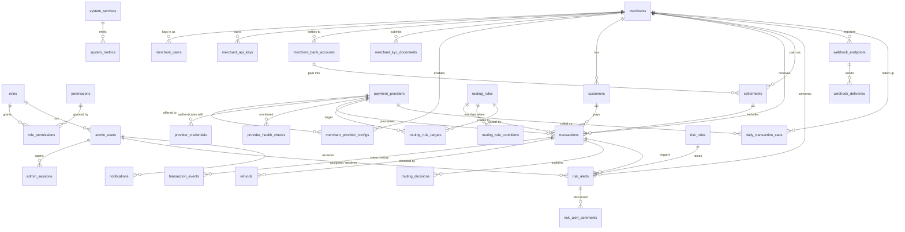

# Purpose Gateway: Database Architecture

**Status:** designed and validated, **not connected**. The UI currently reads mock data from
`assets/js/data.js`. This folder holds everything needed to stand up the real database in Phase 2.

| File | Purpose |
|---|---|
| [schema.sql](schema.sql) | Full PostgreSQL 15+ DDL: types, tables, keys, indexes, triggers, views. **Single source of truth.** |
| [seed.sql](seed.sql) | Reference data (roles, permissions, providers, settings) and demo rows matching the UI mock. |
| [API_CONTRACT.md](API_CONTRACT.md) | Endpoints the frontend already calls, the JSON they return, and the tables behind each one. |

`schema.sql` and `seed.sql` were run end-to-end against a Postgres engine. Result: 36 tables,
53 foreign keys, and the append-only audit trigger works.

---

## 1. Domain map

The schema is grouped into 11 modules, in the same order as the sections of `schema.sql`:

| # | Module | Tables |
|---|---|---|
| 1 | Access control | `roles`, `permissions`, `role_permissions`, `admin_users`, `admin_sessions` |
| 2 | Merchants | `merchants`, `merchant_users`, `merchant_api_keys`, `merchant_bank_accounts`, `merchant_kyc_documents` |
| 3 | Payment providers | `payment_providers`, `provider_credentials`, `provider_health_checks`, `merchant_provider_configs` |
| 4 | Transactions | `customers`, `transactions`, `transaction_events`, `refunds` |
| 5 | Settlements | `settlements` |
| 6 | Smart routing | `routing_rules`, `routing_rule_conditions`, `routing_rule_targets`, `routing_decisions` |
| 7 | Risk | `risk_rules`, `risk_alerts`, `risk_alert_comments`, `risk_blocklist` |
| 8 | Audit & feed | `audit_logs`, `activity_events`, `notifications` |
| 9 | Webhooks | `webhook_endpoints`, `webhook_deliveries` |
| 10 | System | `system_services`, `system_metrics`, `system_settings` |
| 11 | Reporting | `daily_transaction_stats` + views `v_merchant_stats`, `v_risk_summary`, `v_daily_platform_stats` |

## 2. Entity-relationship diagram

> GitHub, VS Code (with a Mermaid extension) and most Markdown viewers render this diagram.

## 3. Key relationships & delete behaviour

| Parent → Child | Cardinality | On delete | Why |
|---|---|---|---|
| `roles` → `admin_users` | 1 : N | RESTRICT | Can't delete a role that is still assigned |
| `merchants` → `transactions` | 1 : N | RESTRICT | Financial records must never disappear. Merchants are soft-deleted (`deleted_at`) |
| `payment_providers` → `transactions` | 1 : N | RESTRICT | Same reason |
| `transactions` → `transaction_events` | 1 : N | CASCADE | History belongs to the transaction |
| `transactions` → `refunds` | 1 : N | RESTRICT | Refunds are financial records |
| `settlements` → `transactions` | 1 : N | SET NULL | A transaction is in at most one settlement |
| `routing_rules` → conditions / targets | 1 : N | CASCADE | Parts of the rule |
| `routing_rules` → `transactions` | 1 : N | SET NULL | Keep the transaction if a rule is deleted |
| `risk_alerts` → `transactions` / `merchants` | N : 1 | SET NULL | Alerts outlive the subject |
| `merchants` ↔ `payment_providers` | M : N | via `merchant_provider_configs` | Per-merchant enablement and pricing |
| `roles` ↔ `permissions` | M : N | via `role_permissions` | RBAC |

## 4. Core tables (field summary)

Full column definitions, types and constraints are in `schema.sql`. These are the fields the dashboard depends on.

**`transactions`**: `txn_ref` (public id), `merchant_id`, `customer_id`, `provider_id`, `routing_rule_id`,
`merchant_order_id`, `idempotency_key`, `amount`, `currency`, `fee_amount`, `net_amount` (generated),
`refunded_amount`, `status` (`initiated → pending → processing → success | failed | cancelled → refunded…`),
`payer_account_mask`, `card_bin`, `provider_txn_id`, `failure_code`, `risk_score`, `risk_action`,
`customer_ip`, `device_id`, `metadata` (JSONB), `completed_at`, `settlement_id`.
Unique per merchant on `merchant_order_id` and on `idempotency_key`, so a retried request can't charge twice.

**`payment_providers`**: `code`, `name`, `type` (mfs/card/bank/wallet), `status`, `is_enabled`, fees, limits,
plus a health snapshot (`uptime_30d`, `success_rate_24h`, `avg_latency_ms`). A monitor job refreshes the
snapshot from `provider_health_checks`, which keeps the "Payment Providers Health" card fast.

**`merchants`**: `merchant_code`, `business_name`, contact fields, `status` (pending/active/suspended/closed),
`kyc_status`, `risk_level`, `mode` (sandbox/live), `settlement_cycle_days`, `suspended_reason`, `approved_by`.

**`routing_rules`**: `name`, `priority` (lower runs first), `strategy`
(priority / weighted / lowest_cost / highest_success / lowest_latency), `status`, `merchant_id` (NULL = global),
validity window. **`routing_rule_conditions`** store `field` + `operator` + JSONB `value`, all ANDed together.
**`routing_rule_targets`** list the candidate providers, each with a priority and weight.

**`risk_alerts`**: `alert_ref`, `type` (suspicious_transaction / unusual_activity / multiple_failures / …),
`severity`, `status` (open / investigating / resolved / dismissed / escalated), links to the transaction,
merchant and rule, `evidence` (JSONB), assignee and resolution.

**`audit_logs`**: `actor_type`, `actor_id`, `actor_name` (snapshot), `action` (code), `action_label` (display),
`entity_type`, `entity_id`, `changes` (before/after JSONB), `ip_address`, `user_agent`.
**Append-only:** a trigger rejects every UPDATE and DELETE.

## 5. Design decisions

- **UUID keys** everywhere, plus short human-readable refs (`txn_ref`, `merchant_code`, `alert_ref`) for the UI and support.
  High-volume logs (`transaction_events`, `audit_logs`, health/metrics) use `BIGSERIAL` for compact, ordered keys.
- **Money:** `NUMERIC(14,2)` with a `currency` column. BDT is the default and multi-currency is ready.
- **Secrets are never stored in plain text.** API keys and session tokens are stored as SHA-256 hashes.
  Provider credentials, bank account numbers, webhook secrets and the MFA secret are stored encrypted (`BYTEA`, app-level/KMS),
  and `key_version` supports key rotation. Only masked values (`account_no_last4`, `payer_account_mask`) are shown in the UI.
- **Dashboard speed:** KPI cards and the analytics chart read `daily_transaction_stats` (a rollup upserted by a job),
  not the raw `transactions` table.
- **Scale path:** partition `transactions`, `transaction_events`, `provider_health_checks`, `system_metrics` and
  `audit_logs` by month (`PARTITION BY RANGE (created_at)`) once volume needs it. The indexes are already time-ordered.
- **Timezone:** every timestamp is `TIMESTAMPTZ` (stored in UTC). The UI shows times in `Asia/Dhaka` (`system_settings.ui.timezone`).

## 6. Phase 2: how to connect

1. Create the database: `createdb purpose_gateway`
2. Apply the schema, then the seed:
   `psql -d purpose_gateway -f database/schema.sql && psql -d purpose_gateway -f database/seed.sql`
   (Replace the placeholder `password_hash` in `seed.sql` first.)
3. Build the API service (Node/Express, NestJS, Laravel, Django… any stack works) that implements
   the endpoints in [API_CONTRACT.md](API_CONTRACT.md). If you want an ORM, generate the models from the live DB
   (`prisma db pull`, `sequelize-auto`, `php artisan` with a schema dump, etc.) so `schema.sql` stays the source of truth.
4. In `assets/js/data.js`, set `USE_MOCK = false` and point `API_BASE` at the API. No other frontend changes are needed.
5. Schedule the background jobs:
   - **Stats rollup** (every 1–5 min) upserts `daily_transaction_stats`
   - **Provider monitor** (every 30–60 s) inserts `provider_health_checks` and refreshes the snapshot on `payment_providers`
   - **Webhook dispatcher** retries `webhook_deliveries` where `status IN ('pending','retrying')`
   - **Settlement builder** (daily) creates `settlements` and sets `transactions.settlement_id`
6. For schema changes after go-live, use a migration tool (Flyway, Prisma Migrate, Knex, Alembic) with `schema.sql` as migration `0001`.
