# Database Architecture — Purpose Gateway Developer Portal

> **Status:** designed and validated, **not connected**. The UI currently reads mock data through
> `assets/js/api.js`. This folder holds everything needed to stand up the database in the next phase.

| File | Purpose |
|------|---------|
| [`schema.sql`](schema.sql) | Full PostgreSQL 15+ schema: enums, tables, keys, indexes, triggers, functions, views |
| [`seed.sql`](seed.sql) | Demo/catalog data matching what the dashboard shows today |
| [`../.env.example`](../.env.example) | Connection settings template |

Both files have been executed end-to-end against PostgreSQL (PGlite, PG 16) to confirm they apply cleanly.

## Applying it later

```bash
createdb purpose_gateway
psql "$DATABASE_URL" -f database/schema.sql
psql "$DATABASE_URL" -f database/seed.sql     # dev / staging only
```

Only one extension is required: `citext` (`gen_random_uuid()` and `sha256()` are built into PostgreSQL 13+).
If you adopt an ORM/migration tool (Prisma, Drizzle, Knex, Laravel, Django …), introspect this schema
(`prisma db pull`, etc.) and treat `schema.sql` as migration `0001`.

---

## Design principles

- **Multi-tenant**: every merchant-owned row has `organization_id`; users join organizations through `organization_members` with a role (`owner` / `admin` / `developer` / `viewer`).
- **Live vs. test isolation**: `environment` (`live` | `test`) is on keys, payments, customers, events, webhooks and usage. Sandbox Mode in the UI simply switches which environment is queried.
- **Money** is `BIGINT` in minor units (1 BDT = 100 poisha). This avoids floating-point errors.
- **Secrets are never stored in plain text.**
  - API keys: only `sha256(key)`, `key_prefix` and `last_four` are stored. The full key is shown once, at creation.
  - Webhook signing secrets and provider credentials must be re-usable, so they are **encrypted** (`bytea`, app-side AES-GCM / KMS) rather than hashed.
  - Sessions store a hashed token.
- **Public IDs** (`pay_…`, `re_…`, `evt_…`, `cus_…`) are exposed in the API. Internal UUIDs never leave the backend.
- **Idempotency**: `payments(organization_id, environment, idempotency_key)` is unique.
- **High-volume data**: `api_request_logs` is range-partitioned by month (add partitions with cron or `pg_partman`). Dashboards read the pre-aggregated `api_usage_daily` table.
- **Audit**: security-relevant actions go to `audit_logs`, and `updated_at` is maintained by trigger on every table that has it.

---

## Entity-relationship diagram

```mermaid
erDiagram
    organizations ||--o{ organization_members : has
    users         ||--o{ organization_members : "belongs to"
    users         ||--o{ user_sessions : has
    users         ||--|| user_preferences : has
    organizations ||--o{ api_keys : owns
    users         ||--o{ api_keys : "created by"

    organizations ||--o{ organization_payment_methods : enables
    payment_methods ||--o{ organization_payment_methods : ""
    organizations ||--o{ customers : has
    organizations ||--o{ payments : receives
    customers     ||--o{ payments : makes
    payment_methods ||--o{ payments : "paid with"
    api_keys      ||--o{ payments : "created via"
    payments      ||--o{ refunds : has

    organizations ||--o{ events : emits
    organizations ||--o{ webhook_endpoints : configures
    webhook_endpoints ||--o{ webhook_deliveries : receives
    events        ||--o{ webhook_deliveries : "delivered as"

    organizations ||--o{ api_request_logs : generates
    organizations ||--o{ api_usage_daily : "rolled up into"

    services      ||--o{ service_status_checks : monitored
    services      ||--o{ service_uptime_daily : summarized
    incidents     ||--o{ incident_updates : has
    incidents     }o--o{ services : "affects (incident_services)"

    onboarding_steps ||--o{ user_onboarding_progress : ""
    users         ||--o{ user_onboarding_progress : completes
    users         ||--o{ notifications : receives

    doc_categories ||--o{ doc_articles : groups
    doc_categories ||--o{ api_endpoints : groups
    api_endpoints ||--o{ code_samples : has

    organizations ||--o{ support_tickets : opens
    support_tickets ||--o{ support_ticket_messages : contains
    organizations ||--o{ audit_logs : records
```



---

## Table dictionary

### 1. Identity & tenancy
| Table | Key fields | Notes |
|---|---|---|
| `organizations` | `id`, `slug` (unique), `default_currency`, `live_mode_enabled`, `status` | The merchant. Live mode unlocks after KYC. |
| `users` | `id`, `email` (citext, unique), `password_hash`, `full_name`, `job_title`, `avatar_url`, `two_factor_*` | Shown in the sidebar profile and top-bar avatar. |
| `organization_members` | `organization_id` → organizations, `user_id` → users, `role` | Unique per (org, user). |
| `user_sessions` | `user_id`, `token_hash` (unique), `expires_at`, `revoked_at` | Dashboard auth. |
| `user_preferences` | `user_id` (PK), `sandbox_mode`, `default_code_language`, `default_usage_range` | Sandbox toggle, default code tab, default chart range. |

### 2. Credentials
| Table | Key fields | Notes |
|---|---|---|
| `api_keys` | `organization_id`, `environment`, `key_type`, `key_prefix`, `last_four`, `key_hash` (unique), `scopes[]`, `allowed_ips[]`, `status`, `last_used_at`, `expires_at`, `revoked_at` | A CHECK constraint keeps the prefix consistent with type and environment (`pk_live_`, `sk_test_` …). |

### 3. Payments
| Table | Key fields | Notes |
|---|---|---|
| `payment_methods` | `code` (bkash, nagad, rocket, visa, mastercard), `kind`, `min_amount`, `max_amount` | Global catalog. |
| `organization_payment_methods` | PK (`organization_id`, `payment_method_id`, `environment`), `is_enabled`, `provider_config_encrypted` | Per-merchant enablement. |
| `customers` | `organization_id`, `environment`, `public_id`, `external_id`, `email`, `phone`, `metadata` | Optional payer record. |
| `payments` | `public_id`, `organization_id`, `environment`, `api_key_id`, `customer_id`, `payment_method_id`, `amount`, `amount_refunded`, `currency`, `status`, `idempotency_key`, `provider_reference`, `failure_*`, `metadata`, `paid_at` | Created by `POST /pay`. |
| `refunds` | `payment_id`, `amount`, `status`, `reason`, `processed_at` | Partial refunds supported. |

### 4. Events & webhooks
| Table | Key fields | Notes |
|---|---|---|
| `events` | `public_id`, `type` (`payment.succeeded` …), `resource_type`, `resource_id`, `payload` | Immutable event log. |
| `webhook_endpoints` | `url`, `enabled_events[]`, `signing_secret_encrypted`, `status`, `consecutive_failures` | Auto-disable after repeated failures. |
| `webhook_deliveries` | `webhook_endpoint_id`, `event_id`, `attempt`, `status`, `response_status`, `duration_ms`, `next_retry_at` | One row per attempt. The partial index drives the retry worker. |

### 5. Usage & analytics
| Table | Key fields | Notes |
|---|---|---|
| `api_request_logs` *(partitioned)* | `request_id`, `organization_id`, `api_key_id`, `method`, `path`, `status_code`, `latency_ms`, `is_sandbox_console`, `created_at` | Raw log. No FKs, for write throughput. |
| `api_usage_daily` | PK (`organization_id`, `environment`, `usage_date`), `total_requests`, `successful_requests`, `client_errors`, `server_errors`, `total_latency_ms`, `p95_latency_ms` | Filled by an hourly/nightly roll-up job. |
| `fn_usage_summary(org, env, days)` | → `total_requests`, `success_rate`, `avg_response_ms`, `error_rate` | Feeds the four stat tiles. |

### 6. System status
| Table | Notes |
|---|---|
| `services` | Payment Processing, API Services, Webhooks, Dashboard; has `current_status`. |
| `service_status_checks` | Health-check samples from the monitor. |
| `service_uptime_daily` | Daily uptime %. `v_platform_uptime_30d` feeds "99.99% Uptime". |
| `incidents`, `incident_services`, `incident_updates` | Status-page incidents. |

### 7. Onboarding & notifications
| Table | Notes |
|---|---|
| `onboarding_steps` | Checklist definition (`step_key`, `position`, `title`, `description`). |
| `user_onboarding_progress` | PK (`user_id`, `step_id`), `completed_at`. |
| `notifications` | Bell dropdown. Unread = `read_at IS NULL` (partial index). |

### 8. Developer content
| Table | Notes |
|---|---|
| `doc_categories`, `doc_articles` | Docs and guides, with a generated weighted `tsvector` and a GIN index for the search bar. |
| `api_endpoints` | API reference (`operation_id`, `method`, `path`, JSON schemas), also full-text indexed. |
| `code_samples` | cURL / Node.js / Python / PHP tabs per endpoint. `{{KEY}}` is replaced client-side. |
| `sdk_libraries` | Package name, version, install command. |
| `tutorials` | "Watch Tutorial" video. |

### 9. Support & 10. Audit
| Table | Notes |
|---|---|
| `support_tickets`, `support_ticket_messages` | Support Center. A ticket can reference an API `request_id`. |
| `audit_logs` | `action` (e.g. `api_key.revoked`), actor, target, IP, metadata. |

---

## UI → data mapping

| UI element | API function (`assets/js/api.js`) | Suggested endpoint | Tables / objects |
|---|---|---|---|
| Sidebar profile, top avatar | `getCurrentUser` | `GET /me` | `users`, `organization_members`, `organizations` |
| Sandbox Mode toggle | `getPreferences` / `updatePreferences` | `GET/PATCH /me/preferences` | `user_preferences` |
| Notifications bell | `getNotifications`, `markAllNotificationsRead` | `GET /notifications`, `POST /notifications/read-all` | `notifications` |
| Search bar | `search` | `GET /search?q=` | `doc_articles`, `api_endpoints` (tsvector) |
| Your API Keys | `getApiKeys` | `GET /api-keys` | `api_keys` |
| API Usage stat tiles | `getUsageSummary` | `GET /usage/summary?range=` | `fn_usage_summary()` over `api_usage_daily` |
| API Usage chart | `getUsageDaily` | `GET /usage/daily?range=` | `api_usage_daily` |
| Getting Started | `getOnboarding`, `completeOnboardingStep` | `GET /onboarding`, `POST /onboarding/{key}/complete` | `onboarding_steps`, `user_onboarding_progress` |
| Code panel | `getCodeSamples` | `GET /code-samples?endpoint=` | `code_samples`, `api_endpoints` |
| Try in Sandbox | `runSandboxRequest` | `POST /sandbox/requests` | `payments` (test), `api_request_logs` (`is_sandbox_console = true`) |
| Live Status, Uptime | `getServiceStatus` | `GET /status` | `services`, `service_uptime_daily`, `v_platform_uptime_30d` |

To connect: implement these endpoints on the backend, then set `USE_MOCK = false` and `API_BASE` in `assets/js/api.js`. The mock objects already use the same field names as the columns.

## Background jobs needed (later phase)
1. **Usage roll-up**: aggregate `api_request_logs` into `api_usage_daily` (hourly upsert).
2. **Partition maintenance**: create next month's `api_request_logs_YYYY_MM` and drop or archive partitions past the retention window (e.g. 90 days).
3. **Webhook dispatcher**: process `webhook_deliveries` where `status = 'retrying' AND next_retry_at <= now()` with exponential backoff.
4. **Status monitor**: write `service_status_checks`, update `services.current_status`, and compute `service_uptime_daily`.
5. **Key expiry**: mark `api_keys` as `expired` once `expires_at < now()`.
