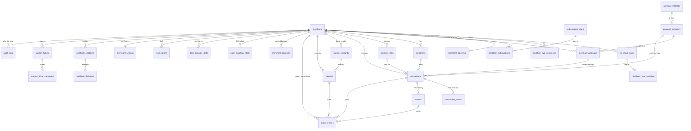

# Purpose Gateway: Merchant Dashboard Database Architecture

> **Status:** the design is complete but **not connected**. The dashboard still runs on
> `assets/js/mock-data.js` through `assets/js/api.js`. This folder holds what you need
> to set up the database later.

| File | Purpose |
|---|---|
| [schema.sql](schema.sql) | Full PostgreSQL 14+ DDL: 28 tables, enums, constraints, indexes, triggers, a view and a KPI function |
| [seed.sql](seed.sql) | Sample data that reproduces the design (Imran Un Nafi, ৳186,420.50 balance, #PGT-78449 to #PGT-78452) |
| this file | ER diagram, table reference, UI-to-DB mapping, API contract and integration plan |

Both SQL files were loaded into a real Postgres engine (PGlite) as a check. The seed produces exactly ৳248,750 revenue, 2,847 transactions and 36 failed payments for November 2025, and the ledger trigger rejects UPDATE and DELETE.

```bash
createdb purpose_gateway
psql -d purpose_gateway -f database/schema.sql
psql -d purpose_gateway -f database/seed.sql
```

---

## 1. Conventions

- **PostgreSQL**, so we get enums, JSONB, partial indexes, generated columns and strong transactions for money.
- **UUID primary keys** on business entities. Small lookup tables (`payment_methods`, `payment_providers`, `subscription_plans`) use `SMALLSERIAL`.
- **Human-readable public IDs** come from sequences: `PGT-78452` (transactions), `PO-10241` (payouts), `TKT-5001` (tickets). The UI shows these. The UUID is internal.
- **Money is a `BIGINT` in minor units** (poisha, where 1 BDT = 100) with a `CHAR(3)` currency column. It is never a float. `24875000` = ৳248,750.00.
- **Timestamps** are `TIMESTAMPTZ` in UTC. The UI renders them in `merchants.timezone` (default `Asia/Dhaka`). A trigger maintains `updated_at`.
- **Multi-tenancy:** every merchant-owned row has `merchant_id`. The API always filters by the logged-in user's merchant. Optional Row-Level Security policies are sketched at the bottom of `schema.sql`.
- **Ledger first:** `ledger_entries` is append-only (enforced by a trigger) and is the source of truth. `merchant_balances` is a cached projection, updated **in the same DB transaction** as each ledger insert.
- **Idempotency:** `transactions` and `payouts` have `UNIQUE (merchant_id, idempotency_key)`. A retried "Withdraw" click can't pay out twice.
- **Secrets are never stored raw.** API keys and refresh tokens are stored as hashes. Gateway credentials and webhook secrets are vault references, and bank account numbers are KMS-encrypted (`BYTEA`) with only the last 4 digits in clear. Card PAN and CVV never touch this database.

---

## 2. Entity-Relationship Diagram



---

## 3. Table Reference

### 3.1 Merchants and access
| Table | What it holds | Key fields |
|---|---|---|
| `merchants` | The business (tenant) | `business_name`, `slug` (used in pay-link URLs), `timezone`, `kyc_status`, `status` |
| `merchant_kyc_documents` | Trade licence, TIN, NID uploads | `document_type`, `file_url` (private storage), `status` |
| `merchant_users` | People who log in. The sidebar shows "Imran Un Nafi · Merchant" | `full_name`, `display_title`, `email` (unique), `password_hash` (argon2id), `role`, `two_factor_enabled` |
| `merchant_user_sessions` | Refresh-token sessions | `refresh_token_hash`, `expires_at`, `revoked_at` |
| `merchant_api_keys` | Server-to-server keys | `key_prefix` (shown), `key_hash`, `environment`, `scopes[]` |

Roles are `owner` (exactly one per merchant, enforced by a partial unique index), `admin`, `finance` (payouts and refunds), `developer` (keys and webhooks), `support` and `viewer`.

### 3.2 Plans ("Upgrade to Pro Plan")
| Table | What it holds | Key fields |
|---|---|---|
| `subscription_plans` | Starter, Pro and Enterprise | `price_minor`, `mfs_fee_bps`, `card_fee_bps` (150 = 1.50%), `monthly_volume_limit_minor`, `max_payment_links`, `features` JSONB |
| `merchant_subscriptions` | A merchant's current plan | `plan_id`, `status`, `current_period_start/end`. At most one live subscription per merchant |

### 3.3 Gateways ("Connected Gateways")
| Table | What it holds | Key fields |
|---|---|---|
| `payment_methods` | mobile_banking, card, wallet, bank_transfer | `code` |
| `payment_providers` | bKash, Nagad, Rocket, Upay, Visa, Mastercard, Bank | `code`, `name`, `brand_color`, `logo_url` (official asset) |
| `merchant_gateways` | Which providers a merchant has switched on | `provider_id`, `environment`, `status`, `credentials_ref` (vault), `display_order`, `connected_at` |

The card shows the first 4 active rows by `display_order`, then "+N" for the rest.

### 3.4 Customers, payment links, transactions
| Table | What it holds | Key fields |
|---|---|---|
| `customers` | Payers, scoped per merchant | `full_name`, `email`, `phone` (each unique per merchant), `total_spent_minor` |
| `payment_links` | "Create Payment Link" | `slug`, `title`, `amount_minor` (NULL means the customer chooses), `max_uses`, `uses_count`, `expires_at`, `status` |
| `transactions` | Every payment attempt (Recent Transactions table) | `public_id` (PGT-…), `amount_minor`, `fee_minor`, `net_minor` (**generated**), `refunded_minor`, `status`, `provider_id`, `payer_account_masked`, `card_last4`, `failure_code/message`, `idempotency_key` |
| `transaction_events` | Status history: pending → success/failed… | `from_status`, `to_status`, `source`, `payload` |
| `refunds` | Full or partial refunds | `amount_minor`, `reason`, `status`, `requested_by` |

`net_minor = amount − fee − refunded`, and it is only non-zero for successful or refunded payments. CHECK constraints stop the refund or fee from exceeding the amount.

### 3.5 Balance and payouts ("Available Balance" and "Withdraw")
| Table | What it holds | Key fields |
|---|---|---|
| `payout_accounts` | Bank account or MFS wallet for withdrawals | `account_type`, `label`, `account_number_enc` + `account_number_last4`, `is_default` (one per merchant) |
| `payouts` | Withdrawal requests | `public_id` (PO-…), `amount_minor`, `fee_minor`, `status`, `provider_reference`, `idempotency_key` |
| `ledger_entries` | **Append-only** money movements. Positive is a credit, negative a debit | `entry_type`, `bucket` (available/pending/reserved), `amount_minor`, `balance_after_minor`, links to transaction/refund/payout |
| `merchant_balances` | Cached totals for the balance card | `available_minor`, `pending_minor`, `reserved_minor`, `version` (optimistic lock). CHECKs stop any value going negative |

**Money flow:** a successful payment posts `payment` (+amount) and `fee` (−fee) to **pending**. Settlement moves the amount to **available** (`settlement_release`). A withdrawal posts `payout` (−amount) to available. A failed payout posts `payout_reversal` (+amount).

### 3.6 Analytics (KPI cards and Revenue Overview)
| Table | What it holds | Key fields |
|---|---|---|
| `daily_merchant_stats` | One row per merchant per local day | `gross_volume_minor`, `net_volume_minor`, `transactions_count`, `success_count`, `failed_count`, `refund_count`, `unique_customers` |
| `daily_provider_stats` | The same, split by provider | for the future "method mix" report |

A worker updates these when a transaction reaches a final status, and a nightly job recomputes yesterday to self-heal. The dashboard never scans `transactions` for KPIs.

### 3.7 Notifications, settings, webhooks, support, audit
| Table | What it holds |
|---|---|
| `notifications` | Bell panel. `merchant_user_id` NULL means it's for the whole team. `read_at` NULL means unread (the red dot) |
| `merchant_settings` | Payout schedule, minimum payout (৳500 default), notification preferences, checkout branding |
| `webhook_endpoints` / `webhook_deliveries` | Outgoing events to the merchant's server, with retries and backoff (`next_retry_at`) |
| `support_tickets` / `support_ticket_messages` | The Support section |
| `audit_logs` | Every sensitive action (payout.create, refund.create, api_key.revoke…) with actor, IP and diff |

---

## 4. UI-to-Database Mapping

| UI element | Source |
|---|---|
| "Welcome back, Imran!", sidebar profile | `merchant_users.full_name`, `display_title`, `avatar_url` |
| Date range (Today / 7 / 30 / 90 days) | `dashboard_summary(merchant_id, days)` over `daily_merchant_stats` |
| Total Revenue + % change | `SUM(gross_volume_minor)` for the current window vs the previous window |
| Success Rate | `success_count / (success_count + failed_count)` |
| Total Transactions | `SUM(transactions_count)` |
| Failed Payments | `SUM(failed_count)`. Red when it goes **up** |
| KPI sparklines | Daily (or hourly for "Today") series from the same table |
| Revenue Overview chart (This Month / Last Month / This Year) | `daily_merchant_stats` grouped by day, or by month for "This Year" |
| Available Balance | `merchant_balances.available_minor` (+ `pending_minor` shown as "pending settlement") |
| Withdraw | `INSERT payouts` + `INSERT ledger_entries` + `UPDATE merchant_balances` in **one** transaction |
| Connected Gateways | `merchant_gateways ⨝ payment_providers` ordered by `display_order` |
| Recent Transactions / Transactions page | `v_transaction_list` filtered by `merchant_id`, ordered by `created_at DESC` (index `idx_tx_merchant_created`) |
| Row ⋯ → Refund | `INSERT refunds` + ledger debit, and transaction status → `refunded` / `partially_refunded` |
| Create Payment Link | `INSERT payment_links` |
| Bell + red dot | `notifications WHERE read_at IS NULL` (index `idx_notifications_unread`) |
| Upgrade to Pro | `subscription_plans` + `merchant_subscriptions` |

---

## 5. API Contract

`assets/js/api.js` already calls these endpoints when `USE_MOCK = false`, and the mock returns the same shapes. All endpoints are under `/api/v1`, authenticated with an httpOnly session cookie and scoped to the user's merchant.

| Method & path | Returns |
|---|---|
| `GET /me` | `{ merchant, user, subscription }` |
| `GET /dashboard/summary?range=last_30_days` | `{ total_revenue_minor, revenue_change_pct, success_rate_pct, success_rate_change_pct, total_transactions, transactions_change_pct, failed_payments, failed_change_pct, sparklines:{revenue,success_rate,transactions,failed} }` |
| `GET /dashboard/revenue?period=this_month` | `{ period, granularity, total_minor, previous_total_minor, change_pct, points:[{date, value_minor}] }` |
| `GET /balance` | `merchant_balances` row |
| `GET /gateways` | `[{ id, code, name, method_code, status, environment, logo_url, connected_at }]` |
| `GET /transactions?search=&status=&page=&page_size=` | `{ data:[TxDTO], page, page_size, total }` |
| `GET /transactions/:public_id` | `TxDTO` |
| `POST /transactions/:public_id/refunds` `{ amount_minor, reason }` | refund |
| `GET /payout-accounts` | `{ accounts, rules:{ min_payout_minor, payout_fee_minor } }` |
| `POST /payouts` `{ payout_account_id, amount_minor }` + `Idempotency-Key` header | payout |
| `POST /payment-links` `{ title, amount_minor \| null, description }` | payment_link (with `url`) |
| `GET /notifications?limit=20` · `POST /notifications/read-all` | list · 204 |

`TxDTO` is the `v_transaction_list` row: `public_id, customer_name, amount_minor, fee_minor, net_minor, refunded_minor, provider_code, provider_name, status, created_at, …`.

---

## 6. Integration Plan (later phase)

1. **Provision** PostgreSQL 14+ and run `schema.sql`. Run `seed.sql` only in dev and staging.
2. **Backend:** build the endpoints in §5 with any stack (Node/Nest, Laravel, Django…). Use a connection pool, parameterised queries only, and `SET LOCAL app.merchant_id` per request if you enable RLS.
3. **Money writes** (payouts, refunds, settlement): one DB transaction that does `SELECT … FROM merchant_balances … FOR UPDATE`, then inserts the ledger row, then updates the balance and bumps `version`. Re-check the balance inside the transaction; never trust the client.
4. **Rollups:** a worker or queue consumer updates `daily_merchant_stats` on each final transaction status, plus a nightly recompute.
5. **Frontend:** set `USE_MOCK = false` in `assets/js/api.js` and stop loading `mock-data.js` in `index.html`. Nothing else in the UI changes.
6. **Hardening:** CSRF protection for cookie auth, rate limits on `POST /payouts` and auth, 2FA required for owner/finance roles before payouts, `audit_logs` written for every write endpoint, and backups with point-in-time recovery.

---

## 7. Security Notes

- No raw card data is stored (PCI scope stays with the processor). Only `card_brand` and `card_last4`.
- Bank account numbers are encrypted at the application layer, with only the last 4 digits in clear for display.
- API keys, refresh tokens and webhook secrets are stored as hashes or vault references, never as plaintext.
- `ledger_entries` cannot be updated or deleted (trigger). Corrections are reversing entries.
- Every merchant-owned query must filter by `merchant_id`. RLS gives defence in depth.
