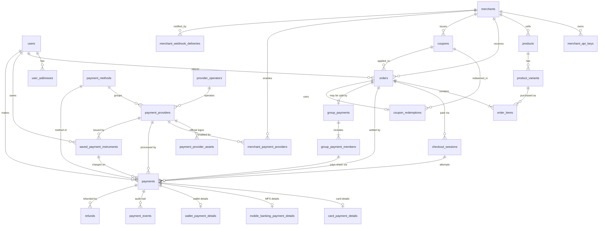

# Purpose Gateway: Database Architecture

> **Status:** Design is complete but **not connected**. The frontend still runs on
> `assets/js/mock-data.js` through `assets/js/api.js`. This folder holds what you need
> to set up the database later.

| File | Purpose |
|---|---|
| [schema.sql](schema.sql) | Full PostgreSQL 14+ DDL: enums, tables, constraints, indexes, triggers and one view |
| [seed.sql](seed.sql) | Sample data that matches the checkout screen (MacBook Air M2, ৳95,000) |
| this file | ER diagram, table reference, design decisions and integration plan |

---

## 1. Conventions

- **PostgreSQL** is the target. It provides enums, JSONB, partial indexes, generated columns and strong transactional guarantees for money.
- **UUID primary keys** on business entities, so IDs can be exposed safely and can't be enumerated. Small lookup tables use `SMALLSERIAL`.
- **Money is stored as `BIGINT` minor units** (poisha, where 1 BDT = 100) with a `CHAR(3)` currency column. It is never a float. `9500000` = ৳95,000.00.
- **Snapshots:** `order_items` copies the product name, attributes and price at purchase time, and `orders.shipping_address` copies the address. Old orders stay accurate when the catalog changes.
- **Timestamps** are `TIMESTAMPTZ` in UTC, and every mutable table has `created_at`/`updated_at` (a trigger maintains the latter).
- **Idempotency:** `payments.idempotency_key` is UNIQUE. If the client sends the same key twice, no second charge is created.

---

## 2. Entity-Relationship Diagram



---

## 3. Table Reference

### Identity
| Table | Description | Key fields |
|---|---|---|
| `users` | Paying customers, i.e. the person behind the header avatar | `email` (unique, citext), `phone` (E.164), `password_hash` (nullable for guests/OAuth), `status` |
| `user_addresses` | Shipping and billing addresses | `type`, `is_default` (partial unique index allows one default per type) |
| `merchants` | Businesses using the gateway | `slug`, `webhook_url`, `status` |
| `merchant_api_keys` | Server-to-server API credentials | `key_hash` only (raw key shown once), `is_live`, `revoked_at` |

### Catalog and promotions
| Table | Description | Key fields |
|---|---|---|
| `products` | A product, e.g. *MacBook Air M2* | `merchant_id`, `name`, `image_url` |
| `product_variants` | Purchasable SKU | `attributes` JSONB `{screen, ram, storage, color}` (feeds the "13.6″ • 8GB RAM • 256GB SSD" line and the *Silver* chip), `price_minor`, `stock_quantity` |
| `coupons` | Discount codes | `discount_type` (percentage/fixed), `discount_value`, `max_discount_minor`, `min_order_minor`, usage limits, validity window |
| `coupon_redemptions` | One row per order that used a coupon | enforces per-user limits |

### Orders (left "Order Summary" card)
| Table | Description | Key fields |
|---|---|---|
| `orders` | Header and price breakdown | `subtotal_minor`, `discount_minor`, `delivery_charge_minor`, `tax_minor`, `total_minor` (a CHECK enforces `total = subtotal − discount + delivery + tax`), `amount_paid_minor`, `status` |
| `order_items` | Line items | snapshot fields, `unit_price_minor`, `quantity`, `line_total_minor` (CHECK-validated) |

### Payment configuration (the 4 method tiles)
| Table | Description | Key fields |
|---|---|---|
| `payment_methods` | Card, Mobile Banking, Wallet, Group | `code` enum, `description` (tile subtitle), `is_popular` ("Popular" badge), `is_new` ("New" badge), `sort_order` |
| `provider_operators` | The licensed institution behind a provider (BRAC Bank, DBBL, UCB, Islami Bank and so on). One operator can run several providers (Islami Bank runs mCash and CellFin). | `code`, `legal_name`, `operator_type`, `regulator`, `license_reference` |
| `payment_providers` | **Card:** visa, mastercard, amex. **Mobile banking:** bkash, nagad, rocket, upay, tap, surecash, ok_wallet, mcash, mycash, firstcash, cellfin. **Wallet:** google_pay, apple_pay. | `operator_id`, `name_bn`, `logo_url`, `brand_color`, `integration_type`, `account_number_length` / `account_number_regex` (Rocket = 11 digits), `is_featured`, `sort_order`, fees, min/max amount |
| `payment_provider_assets` | Official brand files per provider: logo, dark logo, icon, wordmark | `url`, `mime_type`, `width_px`/`height_px` (keep proportions), `source` (where it came from), `approved_at` (unapproved files are never served) |
| `merchant_payment_providers` | Providers each merchant has enabled | composite PK, per-merchant `sort_order` and fee overrides |

**Adding a new payment provider** (for example a new MFS licence) needs no schema or UI change:
1. `INSERT` into `provider_operators` if the operator is new.
2. `INSERT` one row into `payment_providers` under the right `payment_method_id`.
3. Add its official logo to `payment_provider_assets` with `source` and `approved_at`.
4. Enable it per merchant in `merchant_payment_providers`.

The checkout grid is rendered from this data, so the new tile appears automatically. A new *category* of payment (for example "Bank Transfer") is one new `payment_method_code` enum value plus a row in `payment_methods`.

### Checkout flow (the 3-step stepper)
| Table | Description | Key fields |
|---|---|---|
| `checkout_sessions` | One customer checkout attempt | `public_token` (URL `?session=`), `current_step` (`payment_method` → `payment_details` → `complete`), `selected_method_id`, `expires_at`, `status` |

### Payments
| Table | Description | Key fields |
|---|---|---|
| `payments` | One row per payment attempt | `amount_minor`, `fee_minor`, `net_minor` (generated), `status`, `idempotency_key` (unique), `gateway_reference` (the *Transaction ID* on the success screen), `processor_reference` |
| `card_payment_details` | 1:1 card metadata | `card_brand`, `card_last4`, expiry, `card_bin`, `processor_token`, 3-DS result. **No PAN or CVV columns.** |
| `mobile_banking_payment_details` | 1:1 bKash/Nagad/Rocket | `wallet_number_masked`, `provider_transaction_id` |
| `wallet_payment_details` | 1:1 Google Pay/Apple Pay | `wallet_type`, underlying card brand/last4 |
| `saved_payment_instruments` | "Save this card for faster checkout" | `processor_token`, `fingerprint` (dedupe), `display_label`, `is_default` |
| `payment_events` | Append-only audit of status transitions and webhooks | `status_from`, `status_to`, `payload` (scrubbed) |
| `refunds` | Full or partial refunds | `amount_minor`, `status` |

### Group payment
| Table | Description | Key fields |
|---|---|---|
| `group_payments` | A split order | `share_code` (invite link), `split_type` (equal/custom), `total_minor`, `collected_minor`, `expires_at`, `status` |
| `group_payment_members` | Each participant, organizer included | `display_name`, `email`/`phone`, `share_minor`, `invite_token`, `status` (invited → viewed → paid) |

Each member's payment is a normal row in `payments` with `group_member_id` set. When `SUM(paid shares) = total`, the group moves to `completed` and the order moves to `paid`.

### Operations
| Table | Description |
|---|---|
| `processor_webhooks` | Raw inbound webhooks, deduplicated on `(provider_id, external_event_id)`, kept for replay |
| `merchant_webhook_deliveries` | Outbound webhook queue with retry/backoff |
| `audit_logs` | Generic trail of sensitive actions (coupon applied, card saved, refund issued) |

### View
- `v_checkout_summary` returns everything the checkout page header and summary need in a single query.

---

## 4. UI → Database mapping

| UI element | Source |
|---|---|
| Product card (name, specs, Silver chip, ৳95,000 × 1) | `order_items` (`product_name`, `variant_attributes`, `line_total_minor`, `quantity`) |
| Subtotal / Discount / Delivery Charge / Total Amount | `orders.subtotal_minor` / `discount_minor` / `delivery_charge_minor` / `total_minor` |
| Coupon box | `coupons` → writes `orders.coupon_id`, `coupon_code`, `discount_minor` and a `coupon_redemptions` row |
| Stepper 1 → 2 → 3 | `checkout_sessions.current_step` |
| Method tiles and badges | `payment_methods` (ordered by `sort_order`) |
| Visa / Mastercard / AmEx logos, the mobile banking provider grid (11 MFS), Google/Apple Pay | `payment_providers` (+ `payment_provider_assets` for logos, `provider_operators` for the bank line) filtered by `merchant_payment_providers` |
| Card form | Processor tokenization → `payments` + `card_payment_details` (+ `saved_payment_instruments` if "save" is ticked) |
| Mobile banking form | `payments` + `mobile_banking_payment_details` |
| Group payment members | `group_payments` + `group_payment_members` |
| "Pay ৳95,000" | `POST /payments`, which creates a `payments` row with an idempotency key |
| Success screen (Transaction ID, Order number) | `payments.gateway_reference`, `orders.order_number` |
| Avatar menu | `users` |

---

## 5. Planned API endpoints

Each endpoint is already stubbed in [`assets/js/api.js`](../assets/js/api.js). To go live, set `USE_MOCK = false`.

| Method | Endpoint | Tables touched |
|---|---|---|
| `GET` | `/api/v1/checkout-sessions/:token` | `v_checkout_summary`, `order_items`, `payment_methods`, `payment_providers` |
| `PATCH` | `/api/v1/checkout-sessions/:token` | `checkout_sessions` |
| `POST` | `/api/v1/orders/:id/coupon` | `coupons`, `orders`, `coupon_redemptions` |
| `DELETE` | `/api/v1/orders/:id/coupon` | `orders`, `coupon_redemptions` |
| `POST` | `/api/v1/payments` | `payments`, `*_payment_details`, `payment_events`, `group_payments`, `group_payment_members`, `saved_payment_instruments` |
| `POST` | `/api/v1/webhooks/:provider` | `processor_webhooks`, `payments`, `payment_events`, `orders` |

### Payment transaction (pseudo-code)
```sql
BEGIN;
  SELECT ... FROM orders WHERE id = $1 FOR UPDATE;          -- lock order
  INSERT INTO payments (..., idempotency_key) VALUES (...)  -- fails on duplicate key → return existing
  INSERT INTO card_payment_details (...);
  INSERT INTO payment_events (payment_id, event_type, status_to) VALUES (..., 'payment.created', 'initiated');
COMMIT;
-- call processor (outside the transaction) → on result:
UPDATE payments SET status = 'succeeded', paid_at = now() WHERE id = $1;
UPDATE orders   SET amount_paid_minor = amount_paid_minor + $amt,
                    status = CASE WHEN amount_paid_minor + $amt >= total_minor THEN 'paid' ELSE 'partially_paid' END
WHERE id = $order;
```

---

## 6. PCI scope and security

- **Never store the full card number (PAN) or CVV.** The schema has no columns for them on purpose. In production, collect card fields through the processor's hosted fields or SDK, which return a token. Only the token, brand, last4, BIN and expiry reach our database.
- Mobile wallet numbers are stored **masked** (`+88017****5678`).
- API keys and webhook secrets are stored **hashed**. Provider secrets go in a secrets manager or vault, not in `payment_providers.config`.
- Scrub `payment_events.payload` and `processor_webhooks.payload` of PII before storing them.
- Recommended: a dedicated DB role for the app with no `DELETE` on `payments`, `payment_events` or `audit_logs`, and row-level security on merchant-scoped tables when the merchant dashboard is built.

---

## 7. How to set it up (later phase)

```bash
createdb purpose_gateway
psql -d purpose_gateway -f database/schema.sql
psql -d purpose_gateway -f database/seed.sql
```

Then:
1. Build the backend (Node/Express, Laravel, Django, or similar) that implements the endpoints in §5. With an ORM (Prisma, TypeORM, Eloquent), introspect this schema to generate models.
2. In `assets/js/api.js`, set `USE_MOCK = false` and point `BASE_URL` at the backend.
3. Replace the mock card token in `app.js` → `buildPayload()` with the processor's tokenization SDK call.
4. Add a cron/worker to expire `checkout_sessions` and `group_payments`, retry `merchant_webhook_deliveries`, and send group-member reminders.
